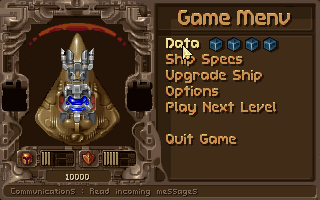

# 自己做一个能玩的端口：OpenTyrian 实战（R36S / XF45V）

> 你说的 “posts” 就是 **PortMaster 的 ports**；“s36s” 我按 **R36S** 理解。
> 你库里那台实机是 **XF45V**，和 R36S 同为 RK3326 / AArch64，这份包两边都能用。
> **Switch 不是同一条路**：它跑的是 Horizon 系统，R36S 的 Linux 二进制不能直接用，必须换 devkitPro + libnx 重编（第五节）。
>
> 本文所有字节数、sha256、报错原文，都是 **2026-10-28 在本机实际跑出来的**（Linux 端口用 zig 0.17.0，Switch 用 devkitPro devkitA64 r30 + gcc 16.1.0）。
> 明确区分两类结论：**本机实测** 与 **未实测**（掌机真机插卡、Switch 上机），最后一节列出。

---

## 一、先看清楚：一个“端口”到底是什么

PortMaster 的端口不是模拟器，也不是 ROM。它就是一个 zip，解开后长这样（拿你库里的真实包举例）：

```
2048.zip
├─ 2048.sh                 ← 必须在 zip 根目录，前端靠它列出游戏
└─ 2048/
   ├─ 2048_libretro.so.aarch64
   ├─ 2048_libretro.so.armhf
   ├─ port.json            ← 元数据
   ├─ gameinfo.xml         ← EmulationStation 的条目
   └─ screenshot.jpg       ← 前端缩略图
```

`a7xpg.zip` 多两样：`libs.aarch64/`（它额外依赖的 .so）和 `a7xpg.gptk`（手柄→键盘映射）。

PortMaster 认包的规则不是口头约定，是 `harbourmaster` 的代码（详见本目录 `02-交叉编译与打包...md` §七）：

| 字段 | 作用 | 填错的后果 |
|---|---|---|
| `items` | zip 顶层有哪些东西；**必须有一个 `.sh`** | 前端列不出启动项 |
| `arch` | `["aarch64"]` / `["armhf"]` | 32 位机器会看到跑不了的包 |
| `rtr` | Ready To Run = 不需要用户自备原版数据 | 用户以为解压即玩，结果缺数据 |
| `min_glibc` | 二进制要求的最低 glibc | 装到老固件上直接崩 |

**一句话**：写端口 = 把“能在 ARM Linux 上跑的可执行文件 + 它要的数据 + 一个启动脚本 + 一份元数据”按这个形状摆好。

---

## 二、需要什么工具

| 你想要的 | 本机现状（实测） | 推荐做法 |
|---|---|---|
| 编 aarch64 Linux 程序 | 没有 gcc/make/cmake/docker/WSL；**只有 zig 0.17.0**（`F:\工具链\zig-x86_64-windows-0.17.0`） | `zig cc -target aarch64-linux-gnu`，免安装、免 Linux |
| 链接 SDL2 | 系统没有 aarch64 SDL2 | 从 Debian arm64 包里取一个 `.so` **只用于链接**；运行时用掌机自带的 SDL2 |
| 打包/验货 | Python 3.13 | zipfile + 本文的 `check_port.py` |
| 上机测试 | 掌机、读卡器或 SSH | SSH 最快：`log.txt` 里能看到全部报错 |
| 做 Switch 版 | **没有 devkitPro** | 装 devkitPro（`switch-dev` + `switch-sdl2`），见第五节 |

在 Linux 上还有一条更省事的路：PortMaster 官方提供 Docker 构建镜像（`ghcr.io/...`），
里面 gcc/aarch64 库都齐。本机没 Docker，所以本文走 zig。

---

## 三、什么样的游戏适合练手（三条硬条件）

1. **有源码、许可能用**：GPL/MIT 都行；反编译项目只收源码、不发素材。
2. **数据能合法拿到**：要么引擎自带免费数据（本文的 Tyrian 2.1 就是作者免费发布），
   要么要求用户自备正版（`rtr:false`）。
3. **依赖少**：最好只依赖 SDL2 + libc。依赖 SDL2_mixer / OpenGL / Python 的，第一次别碰。

本文选的 **OpenTyrian**：52 个 `.c`、只依赖 SDL2 和 libm、Tyrian 2.1 数据免费、GPL-2.0。
你库里的 `ports起手包/opentyrian.zip` 就是官方同款，可以直接对照。

---

## 四、实战：从源码到插卡能玩（本机全程实跑）

成品在 `动手实践/tyrian/`；zip 是 `package/Tyrian.zip`。

### 4.1 备料（实测大小）

| 东西 | 来源 | 字节 |
|---|---|---|
| OpenTyrian 源码 | GitHub `opentyrian/opentyrian` | 310,377（tar.gz） |
| SDL2 头文件 | SDL 2.30.9 源码包 | 7,681,555 |
| 链接用 aarch64 SDL2 | Debian `libsdl2-2.0-0_2.26.5+dfsg-1_arm64.deb` | 565,580（解出 1,862,400） |
| Tyrian 2.1 数据 | 上游 `get_data.sh` → camanis.net | 4,754,048（解出 106 文件） |

数据必须放在 **可执行文件旁边的 `data/`**：引擎 `src/file.c:80-110` 先找 `SDL_GetBasePath() + "data"`，
找不到才看编译时写死的 `TYRIAN_DIR`。

### 4.2 交叉编译（含两条真实报错）

```bash
Z="/f/工具链/zig-x86_64-windows-0.17.0/zig.exe"
cd opentyrian-master
time "$Z" cc -target aarch64-linux-gnu -O2 -std=iso9899:1999 -DNDEBUG \
  -DTARGET_UNIX -DTYRIAN_DIR='"/roms/ports/tyrian/data"' \
  -include stdlib.h -include string.h \
  -I ../SDL2-2.30.9/include \
  src/*.c ../libSDL2-2.0.so.0 -lm -Wl,-s \
  -o ../out/opentyrian.aarch64
```

**报错 1（第一次照 Makefile 编必踩）**

```
src/animlib.c:188:16: error: call to undeclared library function 'malloc'
   188 |   Uint8 *data = malloc(dataSize);
       |                ^
note: include the header <stdlib.h> or explicitly provide a declaration for 'malloc'
```

上游用 GCC 编只报警告，**clang 20 把隐式声明升级成错误**。
`animlib.c`、`editship.c` 漏了 `<stdlib.h>`。最干净的修法是补头文件（`-include stdlib.h -include string.h`），
不要用 `-Wno-error` 放过去——隐式声明会被当成返回 `int`，64 位上指针会被截断。

**报错 2（链接路径的坑）**

```
ld.lld: error: unable to find library -l:F:\开源掌机教程\_scratch\port_demo\libSDL2.so
```

用 `-L.. -lSDL2` 时 zig 把相对路径拼成了 `-l:绝对路径`。
把 `.so` **当普通输入文件直接写在源码后面**即可（`... src/*.c ../libSDL2-2.0.so.0 -lm`）。

**结果**：未 strip 2,389,296 B → `-Wl,-s` 后 **518,624 B**（官方同款 549,992 B）。
编译器缓存热的情况下，全量重编约 6 秒；第一次要现场准备 glibc 头文件，会久一些。

### 4.3 验货：不看机器也知道它是不是 ARM64

```
size 518624  class 2  machine 183
interp /lib/ld-linux-aarch64.so.1
NEEDED ['libSDL2-2.0.so.0', 'libm.so.6', 'libc.so.6']
GLIBC max GLIBC_2.29 ['GLIBC_2.17', 'GLIBC_2.27', 'GLIBC_2.29']
```

- `machine 183` = AArch64；`class 2` = 64 位。
- **没有**打包 SDL2——因为掌机系统自带。你库里 632 个端口包，aarch64 的 `libSDL2-2.0.so.0` 一个都没有，
  只有 x86_64 的两份，这就是“SDL2 由系统提供”的证据。
- `GLIBC_2.29` 是硬门槛。ArkOS 基于 **Ubuntu 19.10 = glibc 2.30**（`上游wiki/arkos/Home.md:21`、`Building.md:3`），
  所以能跑；`port.json` 里老实写 `"min_glibc": "2.29"`，老固件会被 PortMaster 自己挡住。

### 4.4 先在电脑上跑起来（别等上机才发现缺数据）

用同一份源码再编一个 Windows 版，只为了**验证代码、数据、渲染、输入**：

```bash
"$Z" cc -target x86_64-windows-gnu -O2 -std=iso9899:1999 -DNDEBUG -DTARGET_WIN32 \
  -include stdlib.h -include string.h \
  -I ../SDL2-2.30.9/x86_64-w64-mingw32/include/SDL2 src/*.c \
  ../SDL2-2.30.9/x86_64-w64-mingw32/lib/libSDL2main.a \
  ../SDL2-2.30.9/x86_64-w64-mingw32/lib/libSDL2.dll.a \
  -lwinmm -limm32 -lversion -lole32 -loleaut32 -luuid -lsetupapi -lcfgmgr32 \
  -ldinput8 -ldxguid -lshell32 -luser32 -lgdi32 -ladvapi32 -lhid -lm \
  -o ../out/opentyrian.exe
```

把 `SDL2.dll` 和 `data/` 放 exe 旁边，双击即可。实跑截图（640×400 客户端）：



**这里踩了一个不是代码问题的坑**：一开始放在 `F:\开源掌机教程\_scratch\...`（含中文），
游戏弹框 `The Tyrian data files were not found`——文件明明在。
原因是 Windows 的 `fopen` 拿到的是 UTF-8 路径，msvcrt 按 ANSI 代码页解析，中文路径打不开。
挪到 `F:\portdemo_test` 立刻正常。**掌机上路径是 `/roms/ports/...`，不会踩这个坑，但你在电脑上调试会。**

### 4.5 打包：五个必需件

```
Tyrian.sh
tyrian/
├─ opentyrian.aarch64      518,624 B
├─ data/                   106 文件 / 11,483,700 B
├─ tyrian.gptk             手柄映射（直接抄官方包，省得自己调）
├─ conf/opentyrian/opentyrian.cfg
├─ port.json               718 B
├─ gameinfo.xml            527 B
├─ screenshot.png          53,804 B
├─ COPYING                 GPL-2.0（发 GPL 二进制必须附）
└─ opentyrian.md           来源/改动/许可说明
```

**启动脚本**（`Tyrian.sh`，核心十行；完整文件在成品里）：

```bash
source $controlfolder/control.txt    # 找 PortMaster 的 control.txt
get_controls                          # 摇杆/按键环境
GAMEDIR="/$directory/ports/tyrian"
> "$GAMEDIR/log.txt" && exec > >(tee "$GAMEDIR/log.txt") 2>&1   # 所有输出进 log.txt
export XDG_CONFIG_HOME="$GAMEDIR/conf"   # 配置/存档写进端口目录
cd "$GAMEDIR"
$GPTOKEYB "opentyrian.${DEVICE_ARCH}" -c "$GAMEDIR/tyrian.gptk" &
pm_platform_helper "$GAMEDIR/opentyrian.${DEVICE_ARCH}"
"./opentyrian.${DEVICE_ARCH}" -j        # -j 关引擎自带手柄，避免和 gptokeyb 抢键
pm_finish
```

`-j` 不是我发明的：官方 `opentyrian.md` 里写的就是“把 `ignore_joystick` 改成 true”，
我们用它自带的命令行开关 `--no-joystick`，不改进源码。

**全屏配置有个反直觉的格式**。我一开始按 INI 写了 `[video]` / `fullscreen=0`，结果引擎根本不认。
读 `src/config_file.c:604-640, 989` 才知道它自己的语法是：

```
section video
	item fullscreen 0
```

改对之后在 Windows 上实测：窗口从 640×400 变成 **1920×1080 全屏**（屏幕原生分辨率），确认配置生效。
`fullscreen_display = 0` 表示“显示 0 号屏的全屏桌面”，不是布尔值。

### 4.6 自检：22/22

```bash
python -X utf8 check_port.py package/Tyrian.zip
```

实测输出（节选）：

```
PASS  根目录有 .sh 启动脚本  <- ['Tyrian.sh']
PASS  port.json 顶层 5 键  <- 缺: []
PASS  attr 12 键  <- 缺: []
PASS  items 与实际条目一致  <- 缺: []
PASS  e_machine=183 (AArch64)  <- machine=183
PASS  NEEDED 含 libSDL2-2.0.so.0  <- ['libSDL2-2.0.so.0', 'libm.so.6', 'libc.so.6']
PASS  min_glibc 覆盖二进制需求  <- 二进制最高 GLIBC_2.29 / 声明 2.29
PASS  data/ 文件数 >= 100  <- 106
PASS  含 GPL 许可证副本
...
22/22 通过
```

第一次跑是 **21/22**，FAIL 在 `data/tyrian.lvl 存在`——是我把文件名写错了，实际是 `tyrian1.lvl`…`tyrian4.lvl`。
校验器抓出来的，不是靠肉眼。

### 4.7 上卡与三种测试

成品：`package/Tyrian.zip`，**5,039,180 B**，
sha256 `944c62e1c6355c8c296fc79269cee3b41d3f8f811472f0b1192f85d7e8234f46`。

**路 A（最省事）**：把 zip 放到卡里 `/roms/ports/`，解压，使结构变成
`/roms/ports/Tyrian.sh` + `/roms/ports/tyrian/`，重启前端，在 Ports 菜单里启动。

**路 B（SSH，最快看到报错）**：

```bash
scp Tyrian.zip root@<掌机IP>:/roms/ports/
ssh root@<掌机IP>
cd /roms/ports && unzip -o Tyrian.zip && chmod +x Tyrian.sh
bash /roms/ports/Tyrian.sh
tail -f /roms/ports/tyrian/log.txt
```

**路 C（只验二进制能不能被系统加载）**：

```bash
cd /roms/ports/tyrian
ldd ./opentyrian.aarch64          # 应能看到 libSDL2-2.0.so.0 => /usr/lib/...
./opentyrian.aarch64 -j           # 直接跑，看是缺库还是缺数据
```

成功长什么样：Tyrian 标题菜单全屏铺满，方向键选菜单、回车确认（gptk 映射：A=回车、B=空格、Start=Esc）。

**本机没有接掌机，所以真机这一段是“待你执行”**，我不把它写成“已通过”。

---

## 五、把游戏搬到 Switch：完全是另一套工具链

R36S 是 **ARM Linux + glibc**；Switch 是 **ARM Horizon + libnx**。
同一个 C 程序要**重新编译**，不是换个后缀。

### 5.1 三条路线，先选对

| 路线 | 干什么 | 例子 | 你要准备 |
|---|---|---|---|
| A 源码重编 | 用 devkitPro 把开源引擎编成 `.nro` | OpenTyrian、Doom、Cave Story | 源码 + 数据 |
| B 加载器 | 写个壳，加载安卓版官方 `.so` | GTA III/VC、Max Payne | 你自己的正版 APK/OBB + 壳工程 |
| C 反编译重编译 | 把原版二进制逐函数还原再编 | 各种 `*Recomp` | 只收源码，成品有版权风险 |

新手先走 A。

### 5.2 工具清单（下面这套是真装上了的）

| 组件 | 本次实际版本 / 大小 |
|---|---|
| devkitPro 的 MSYS2 引导包 `msys-2.10.0.1.7z` | 112,134,749 B → 解压 967,194,538 B / 23,908 文件 |
| 装完 `F:\devkitPro` 总占用 | 1,560.9 MiB / 25,115 文件 |
| devkitA64 | **r30** |
| `aarch64-none-elf-gcc` | **16.1.0** |
| binutils | 2.46.0 |
| libnx | **4.12.0** |
| switch-sdl2 | **2.28.5-4** |
| switch-mesa（SDL2 的 EGL 依赖它） | 20.1.0-5 |
| `elf2nro` / `nacptool` / `nxlink` | 随 `switch-tools` |

只装两个包就够：

```bash
pacman -S --noconfirm --needed switch-dev switch-sdl2
```

`switch-sdl2_image/mixer/ttf` 这个游戏用不到；网络对战在 `WITH_NETWORK` 宏里，不定义就不会拉 `SDL2_net`。

### 5.3 工程长什么样

```
opentyrian-switch/
├─ Makefile          ← 官方 templates/application 模板，只改 5 处
├─ source/           ← 52 个 .c + 头文件
├─ romfs/data/       ← 106 个数据文件，会被 elf2nro 打进 .nro
├─ icon.jpg          ← 256×160，hbmenu 里显示的图标
└─ opentyrian.nro    ← 成品，单文件
```

`DATA` 和 `ROMFS` 不是一回事：`DATA` 是把文件编成 `.o` 链进二进制（`bin2o`），
`ROMFS` 是打包成 romfs 镜像挂在 `.nro` 尾部、运行时用 `romfs:/` 读。**11 MB 的游戏数据必须走 ROMFS**。

相对模板只改这五处：

| 位置 | 改成 |
|---|---|
| `TARGET` / `SOURCES` | `opentyrian` / `source` |
| `ROMFS` | `romfs` |
| `CFLAGS` | 加 `-I$(PORTLIBS)/include/SDL2`、`-std=iso9899:1999`、`-DTYRIAN_DIR='"/romfs/data"'` |
| `LIBS` | `-lSDL2 -lEGL -lGLESv2 -lglapi -ldrm_nouveau -lstdc++ -lm -lnx` |
| 源码 | `opentyr.c` 顶部 `#include <switch.h>`，`main()` 第一行加 `romfsInit()` |

`romfsInit()` 不能省。不挂 romfs，`romfs:/data/tyrian1.lvl` 读不到，游戏直接停在 “data files were not found”。
libnx 4.12 里它是内联包装，反汇编看到的是 `bl romfsMountSelf`——这也是我们验证它真被调用的办法。

### 5.4 编出来的东西（本机实跑）

```
$ make -j8
...
Writing .../romfs/data/voicesc.snd to RomFS image...
built ... opentyrian.nro

opentyrian.nro   18,825,002 B
opentyrian.elf   18,066,112 B（未 strip）
```

上机：

```bash
nxlink -s opentyrian.nro          # 同一局域网，主机开 netloader
```

或者直接把 `.nro` 拷到卡里：

```
SD:/switch/opentyrian/opentyrian.nro
```

主机上按住 **R** 打开任意游戏进 hbmenu → 启动。数据已在 romfs 里，**不用**再拷 `data/`。

成品、Makefile、一键重建脚本都在 `01-教程库/移植原理/动手实践/switch/`。

### 5.5 链接期的四连错（按出现顺序，照着加库就行）

| 报错 | 根因 | 修法 |
|---|---|---|
| `fatal error: SDL_types.h: No such file or directory` | 源码按 SDL1 习惯写 `#include "SDL.h"`，而 switch-sdl2 的头在 `portlibs/switch/include/SDL2/` | `-I$(PORTLIBS)/include/SDL2` |
| `undefined reference to 'eglGetError'` | `libSDL2.a` 引用了 EGL，但 `-lSDL2` 不会自动带出 | `-lEGL` |
| `undefined reference to 'operator new(unsigned long)'` / `std::__throw_length_error` | `libEGL.a` 里是 mesa 的 C++ 代码，用 C 链接器不会自动带 libstdc++ | `-lstdc++`，**放在 `-lEGL` 后面** |
| `undefined reference to 'nouveau_pushbuf_kick'`，接着 `powf/exp2f/log2f` | mesa 还依赖 nouveau 和 libm | `-lglapi -ldrm_nouveau`，最后补 `-lm` |

顺序不能乱：`-lSDL2` 最前，`-lstdc++/-lm` 在后，**`-lnx` 永远最后**。

### 5.6 装 devkitPro 本身的三个坑（这台机器上真实发生）

1. **Cloudflare 按 UA 拦包站**。`pkg.devkitpro.org` 对 curl 的默认 UA、对 `HeadlessChrome` 都返回 403
   “Sorry, you have been blocked”，换成普通 Chrome UA 就 200。官方 `devkitProUpdater-3.0.3.exe`（196,304 B）
   只是个 NSIS 引导器，真正下载的是 `msys-2.10.0.1.7z`；引导器在这种网络下会卡住。
   本机的做法是手工铺开：Chrome UA 下引导包 → 7z 解到 `F:\devkitPro` → 改 `etc/fstab` 映射
   `/opt/devkitpro` → `pacman.conf` 的 `[options]` 里加 `XferCommand` 用 curl 带 Chrome UA
   （**写进 `[dkp-libs]` 下面不生效**）→ 手工把 `dkp-libs.db` / `dkp-windows.db` 放进
   `var/lib/pacman/sync/`（pacman 自己的 UA 同步不下来）→ 再 `pacman -S`。
2. **msys2 里的 curl 默认走 IPv6 直连**，一样 403。跑 pacman 必须带上
   `http_proxy/https_proxy=http://127.0.0.1:7890`。
3. 附带一条：**msys2 拿到中文路径会乱码**（`cd: $'F:/f/\xbf\xaa...'`）。
   构建目录一律用纯英文，编完再把 `.nro` 拷回中文目录。

### 5.7 验证到哪一步

**已验证（有输出为证）**

- 编译、链接、`elf2nro` 全过；`.nro` 18,825,002 B。
- NRO 头与官方模板 `tplapp.nro` **逐字节同构**：前 16 字节 `20 00 00 14 f0 00 00 00 "HOMEBREW"`，紧跟 `NRO0`。
- romfs 镜像里能搜到 `tyrian1.lvl`、`voices.snd`、`opentyrian.cfg`。
- `opentyrian.elf`：ELF64 / AArch64 / `Type: DYN`（PIE）。
- `main` 反汇编第一条外部调用是 `bl romfsMountSelf`。
- NACP：name=`OpenTyrian`、author=`OpenTyrian Team`。
- 用 `build_switch.sh` 重编：字节数完全一致，sha256 会变（调试信息里带构建路径）。

**没验证（不冒充）**

- **没有在真机或模拟器上跑过**：本机没有 Switch，也没有 keys/firmware，装不出能用的模拟器。
  所以“能进标题、能开一局、手柄和音频正常”这三条，目前都还没有人看到过。

### 5.8 Switch 侧最容易翻车的三件事

- **把 R36S 的 ELF 改名成 .nro**：不行。ELF ≠ NRO，系统也不认 Linux 系统调用。
- **以为 SDL2 自带**：Switch 的 SDL2 要 `switch-sdl2` 端口库，而且还要 `-lEGL -lGLESv2 -lglapi -ldrm_nouveau -lstdc++ -lm`。
- **直接写文件到 romfs**：romfs 只读，存档/配置必须走 `sdmc:`。

---

## 六、这次踩到的坑（照这个表排查，能省半天）

| 现象 | 根因 | 修法 |
|---|---|---|
| `error: call to undeclared library function 'malloc'` | clang 20 把隐式声明当错误；源码漏 `<stdlib.h>` | 补头文件，别用 `-Wno-error` 糊过去 |
| `unable to find library -l:F:\...` | `-L.. -lSDL2` 被拼成绝对路径 | 把 `.so` 当普通输入文件写在源码后 |
| 数据明明在，却报 `data files were not found` | exe 路径含中文，Windows `fopen` 按 ANSI 解析 UTF-8 | 调试时放纯英文路径；掌机路径本来就是 ASCII |
| 只看到一个标题为 `Error` 的窗，控制台没输出 | `logFatal` 走 `SDL_ShowSimpleMessageBox` | 用 Win32 `EnumChildWindows` 读弹窗文字（或用 log.txt） |
| 写了 `[video] fullscreen=0` 不生效 | 引擎配置不是 INI，是 `section` / `item` | 见 4.5 的正确格式 |
| 上机提示 `GLIBC_2.xx not found` | 二进制要求的 glibc 高于固件 | 降 glibc 档位或换旧工具链；`min_glibc` 写实话 |
| 32 位机器看到包但装不上/跑不了 | `arch` 只写了 `aarch64` | 要么补 armhf 构建，要么接受只支持 64 位 |
| 进游戏按键没反应/乱跳 | 引擎自带手柄轮询和 gptokeyb 抢输入 | 启动加 `-j`，按键统一走 gptk |
| Switch：`fatal error: SDL_types.h` | 源码按 SDL1 习惯包含头，switch-sdl2 在 `include/SDL2/` 下 | `-I$(PORTLIBS)/include/SDL2` |
| Switch：一串 `undefined reference`（eglGetError / operator new / nouveau_pushbuf_kick / powf） | 静态库依赖没按顺序补齐 | 见 5.5：`-lEGL -lGLESv2 -lglapi -ldrm_nouveau -lstdc++ -lm`，`-lnx` 最后 |
| Switch：启动就 `data files were not found` | 没有挂 romfs，`romfs:/data` 读不到 | `main()` 第一行 `romfsInit()` |
| Switch：msys2 报 `cd: $'F:/f/\xbf\xaa...'` | msys2 把中文路径按错编码解析 | 构建目录用纯英文，编完再拷回中文目录 |
| 下 devkitPro 包 403 `Sorry, you have been blocked` | Cloudflare 按 UA 拦；msys 的 curl 还会走 IPv6 直连 | 换普通 Chrome UA；pacman 的 `XferCommand` 放 `[options]`；跑 pacman 带 `http_proxy` |

---

## 七、法律边界（这节别跳过）

- ✅ 编 **GPL/MIT 开源引擎**，附上 `COPYING` 和源码地址（GPL 要求）。
- ✅ 打包 **作者免费发布的数据**（Tyrian 2.1 属于这种）。
- ✅ 要求用户 **自备正版数据** 的包，`rtr` 填 `false`、`availability` 写清楚。
- ❌ 把商业游戏的数据/ROM/BIOS/APK/OBB 打进你的包再发。
- ❌ 把别人基于商业游戏重编译出来的成品（`.nro`/二进制）当自己的端口发；本库对这类只收源码。

---

## 八、复核清单（你可以照着重新跑一遍）

```bash
# 1. 二进制架构/依赖/glibc
python -X utf8 check_port.py "01-教程库/移植原理/动手实践/tyrian/package/Tyrian.zip"

# 2. 包内结构与真实字节数
python - <<'PY'
import zipfile
z=zipfile.ZipFile(r"01-教程库/移植原理/动手实践/tyrian/package/Tyrian.zip")
print(len(z.namelist()),"entries")
print(sum(i.file_size for i in z.infolist()),"uncompressed bytes")
PY

# 3. 从零重建二进制（会自己下载源码/头文件/数据）
bash "01-教程库/移植原理/动手实践/tyrian/build.sh"

# 4. 从零重建 Switch 版（需要 F:\devkitPro，构建目录用纯英文）
bash "01-教程库/移植原理/动手实践/switch/build_switch.sh"
```

成品与源码位置：

- 包：`01-教程库/移植原理/动手实践/tyrian/package/Tyrian.zip`
- 校验器：`01-教程库/移植原理/动手实践/tyrian/check_port.py`
- 构建脚本：`01-教程库/移植原理/动手实践/tyrian/build.sh`
- Switch 成品：`01-教程库/移植原理/动手实践/switch/opentyrian.nro`（Makefile / 重建脚本 / README 同目录）
- 第二个端口（换一组“引擎+数据都可再分发”的组合）：
  `01-教程库/移植原理/动手实践/doom/` —— GPL-2.0 的 doomgeneric + BSD 的 Freedoom 0.13.0，
  `package/Doom.zip` 10,711,009 B、`check_port.py` 19/19、无音效；`build.sh` 复跑与手工构建字节一致
- 第三个端口（3D 游戏、要右摇杆鼠标转身）：
  `01-教程库/移植原理/动手实践/quake/` —— GPL-2.0 的 QuakeSpasm 0.97.0 + LibreQuake v0.09-beta
  免费战役（美术 BSD-3 / QuakeC GPL-2.0），`package/Quake.zip` 25,905,909 B、`check_port.py` 22/22、
  音效有 / OGG 音乐未接；源码零改动，换构建目录复跑二进制与 zip 的 sha256 一致
- 第四个端口（第一个“大作本体”、走“引擎开源 + 商业数据自备”）：
  `01-教程库/移植原理/动手实践/quake2/` —— GPL-2.0 的 Yamagi Quake II（commit `9dbf699`），
  `package/Quake2.zip` 1,509,627 B、`check_port.py` **39/39**；包内三个渲染器
  （默认 GLES1 硬加速，另有 gl1/soft 兜底）+ `baseq2/game.so`，**不带任何商业 pak**，
  `rtr=false` 且有“包里不许出现 `baseq2/pak*.pak`”的硬断言
- 第五个端口（第一个要“桌面 GL → GLES”转译的大作）：
  `01-教程库/移植原理/动手实践/quake3/` —— GPL-2.0 的 ioquake3（commit `87a99d18`），
  `package/Quake3.zip` 1,689,475 B、`check_port.py` **38/38**；渲染器是运行时 dlopen 的
  `renderer_opengl1.so`（`cl_renderer` 默认 opengl2，必须在启动参数里强制 opengl1），
  RK3326 这类只有 GLES 的机器靠随包的 **gl4es**（自己编的 `libGL.so.1`/`libEGL.so.1`）转译，
  由 `libgl_${CFW_NAME}.txt` 的 `LIBGL_FB` 决定接不接；音频走 SDL2 后端（不用 OpenAL——
  那版要 libstdc++ 且要 GLIBC_2.38）；**不带任何 `pak*.pk3`、不带 `q3key` 序列号**，`rtr=false`
- 第六个端口（纯引擎包，数据全靠用户）：
  `01-教程库/移植原理/动手实践/wolf3d/` —— GPL-2.0+ 的 ECWolf 1.4.2（commit `ca1143e`），
  `package/Wolfenstein 3D.zip` 1,229,931 B、`check_port.py` **42/42**；自带 `ecwolf.pk3`
  （源码 `wadsrc/` 生成的文本定义，**不含 id 美术/地图**）、自己用 zig 编的最小
  SDL2_mixer（只留 WAV/Ogg-stb）与 SDL2_net，`libSDL2` 交给 CFW；**不带 `*.WL6`/`*.SOD`**，
  本机用免费分享版 WL1 编 Windows 版实跑到 E1L1；这一份踩的坑最偏工程——Ninja 不认
  `CMAKE_AR_ARG1`、`Windows-GNU.cmake` 又盖回归档规则、`windres` 要自写桩、gdtoa 的
  `arith.h` 得用宿主编译器现算
- 第七个端口（商业大作的源码级重制引擎，数据全靠用户）：
  `01-教程库/移植原理/动手实践/diablo/` —— Sustainable Use License 1.0 的 DevilutionX 1.6.0-dev
  （commit `aa3dc7b1`），`package/Diablo.zip` 4,915,310 B、`check_port.py` **33/33**；二进制
  4,092,016 B、只要 `libSDL2-2.0.so.0`（libc++ 静态链入、不带 libstdc++），随包 184 个引擎界面
  资源（CLX 字体/UI/txtdata/lua），**不带 DIABDAT.MPQ/spawn.mpq**；难度全在依赖树——
  zlib/bzip2/lua/sol2/SDL2_image+libpng/SDL_audiolib/libsmackerdec/mpqfs/tl/SheenBidi/
  unordered_dense/magic_enum 十二个子依赖都要交叉编；九处坑：Debian multiarch 的 SDL2 cmake
  路径与 `_real_SDL_config.h` 展平、`libm not found` 要预置 `LIBM`、libpng 生成脚本直接调
  `${CMAKE_C_COMPILER} -E` 要 `.cmd` 包装、中文 cmake 安装路径写进 `.bat` 导致“系统找不到指定的
  路径”、16-LUT 关掉会撞上游 `primitive_render.cpp` 的未更新重载；实跑验证走免费 `spawn.mpq`
- 第八个端口（一个包两个游戏，且第一次需要**自己定位引擎渲染 bug**）：
  `01-教程库/移植原理/动手实践/cnc/` —— GPL-3.0 + EA 附加条款的 Vanilla Conquer（commit
  `ce83b59`）同时编出《泰伯利亚黎明》和《红色警戒 1》，`package/Cnc.zip` 2,121,783 B、
  `check_port.py` **61/61**；两个二进制各自只要 `libSDL2-2.0.so.0` + 随包的 `libopenal.so.1`
  （CFW 普遍没装 OpenAL，必须自带；libc++ 静态链入），**不带任何 `.MIX`**，`td/` 与 `ra/`
  分目录放是因为两代游戏大量 MIX 同名；难度不在依赖树而在**画面**——640x400 高分模式的
  32 万字节插值表有三条路径会让它保持全零，整屏变成黑白棋盘格：`Read_Interpolation_Palette`
  读短 `.PAL` 仍标记“已加载”、`Play_Movie` 清表后没有 `.VQP` 就没人重建、`VQA_SetPalette`
  在无 `.VQP` 时直接跳过；三处一共 39 行补丁（另加淡出 `RemapTables` 越界写）。定位方法是
  临时探针打出表的首字节 + 开关 `PlayIntro` 二分；OpenAL 要钉 1.24.2（master 已上 C++20
  modules）、zig + libc++ 要 `-include cstdlib`；`-DSDL2_LIBRARY=` 这类绝对路径会被 cmake
  写进 RPATH，两个工程都要 `-DCMAKE_SKIP_RPATH=ON`，自检里逐条查有没有残留构建机路径；
  实跑验证走 2007 年免费 GDI95 数据
- 第九个端口（第一次**连素材都是自由的**，`rtr:true` 开箱即玩）：
  `01-教程库/移植原理/动手实践/openttd/` —— GPL-2.0 的 OpenTTD 15.3（commit `14ec60f2`，
  源码**零补丁**）跑 1994 年《运输大亨豪华版》的开源重制，`package/OpenTTD.zip`
  20,259,152 B、`check_port.py` **45/45**；二进制 12,347,832 B、只要 `libSDL2-2.0.so.0`，
  随包 OpenGFX 7.1 / OpenSFX 1.0.3 / OpenMSX 0.4.2 三套可再分发素材（约 19 MB）和
  6 份 `lang/*.lng`；`lang/` 不是装饰——缺了引擎报 `No available language packs` 直接退出，
  一个界面都进不去，而 `.lng` 是构建期由 strgen 从 `src/lang/*.txt` 生成的。难点全在交叉：
  宿主 `strgen` 得先用 zig 编成 `x86_64-windows-gnu` 再用 `-DHOST_BINARY_DIR=` 指过去；
  `rev.cpp` 故意嵌 `__DATE__` 撞 `-Werror=date-time`；PCH 的对象 lld 读不了要关预编译头；
  fmt 在 libc++ 下又缺 `<cstdlib>`；`__FILE__` 把 201 处构建机路径带进二进制，靠
  `-ffile-prefix-map` 洗掉并改 `-DGLOBAL_DIR`；Windows 验证构建还缺 `windres`，写了个
  CRLF 纯 ASCII 的 `rcstub.cmd` 顶替；实跑验证走同一 commit 的 Windows 版本，进到游戏内
  （城镇、日期、资金栏正常）
- 本页所有命令的原始记录：`01-教程库/移植原理/动手实践/tyrian/README.md` 与 `.../switch/README.md`、`.../doom/README.md`、`.../quake/README.md`、`.../quake2/README.md`、`.../quake3/README.md`、`.../wolf3d/README.md`、`.../diablo/README.md`、`.../cnc/README.md`、`.../openttd/README.md`

---

## 九、这次到底测了什么、没测什么

**本机实测（有产物/截图/输出为证）**

- aarch64 交叉编译成功，ELF 183、依赖 `libSDL2-2.0.so.0/libm/libc`、最高 `GLIBC_2.29`。
- 同一份源码的 Windows 版真实启动到标题菜单并截图（`screenshot.png`，640×400）。
- `port.json` 12 键、items、data 106 文件、GPL 副本等 22 项校验全过。
- `section video / item fullscreen 0` 配置在 Windows 上实测生效（1920×1080 全屏）。
- Switch：devkitPro（devkitA64 r30 / gcc 16.1.0 / libnx 4.12.0 / switch-sdl2 2.28.5-4）装好并编出
  `opentyrian.nro` 18,825,002 B；NRO 头与官方模板同构、romfs 内 106 个数据文件可检索、
  `main` 首条外部调用是 `romfsMountSelf`、NACP 名称/作者正确。

**未实测（不冒充）**

- 真机 R36S / XF45V 插卡启动：本机没接掌机。按 4.7 的两条命令跑，失败先看 `tyrian/log.txt`。
- Switch 的 `.nro` 在真机/模拟器上运行：`.nro` 编出来了（18,825,002 B），结构与 romfs 都验过，
  但本机没有 Switch、也没有 keys/firmware，**没有真正启动过**。上机前别把“编译通过”当“能玩”。
