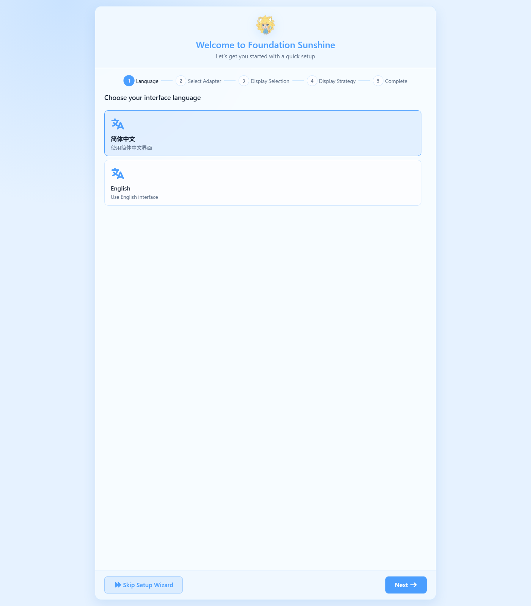
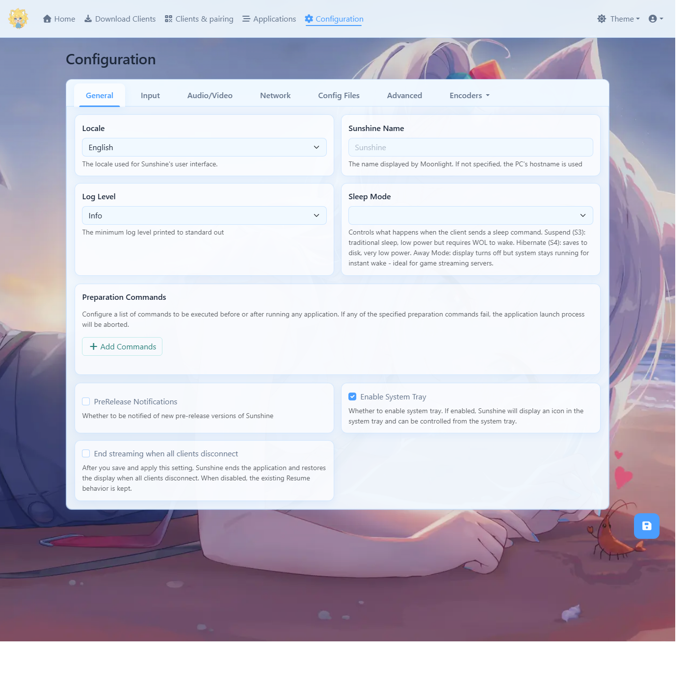
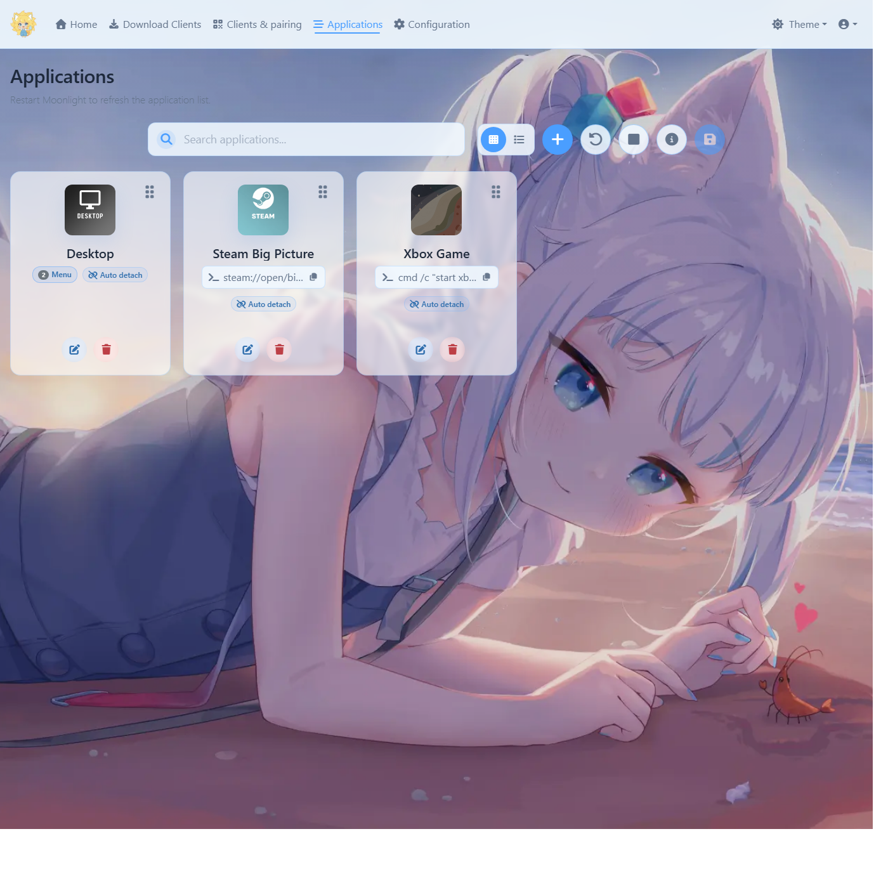
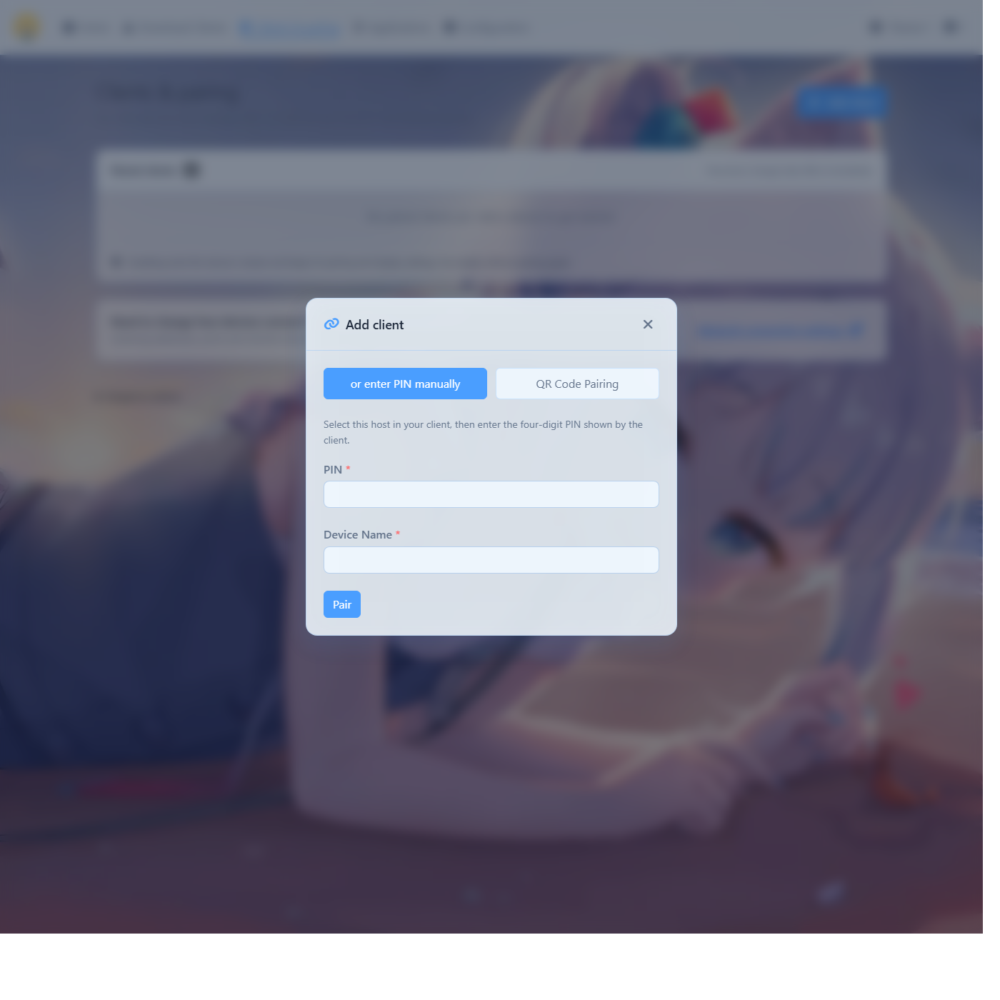

# Foundation Sunshine 部署运行说明书

**适用版本**：v2026.1031.121458（2026-10-31 发布，`AlkaidLab/foundation-sunshine`）
**适用系统**：Windows 10 22H2（19045）及以上
**本机部署形态**：便携版，装在 `F:\foundation-sunshine\`，C 盘零写入
**编写日期**：2026-11-02

Foundation Sunshine 是 Sunshine 的 Windows 优化分支，作用是把这台电脑变成一台"串流主机"：掌机、手机、平板上的 Moonlight 客户端连上来，就能看电脑桌面、玩电脑上的游戏。它是**发送端**（主机），Moonlight 是**接收端**（客户端）。

---

## 0. 本机当前状态一览

| 项目 | 实测结果 |
|---|---|
| 程序位置 | `F:\foundation-sunshine\Sunshine\sunshine.exe` |
| 配置位置 | `F:\foundation-sunshine\Sunshine\config\` |
| 占用空间 | 整个 `F:\foundation-sunshine\` 共 144MB |
| 运行方式 | 普通用户进程（**不是** Windows 服务） |
| 管理界面 | `https://127.0.0.1:47990/` |
| 监听端口 | TCP 47984 / 47989 / 47990 / 48010 / 48020 |
| 显卡编码 | RTX 5060 Ti 上 H.264 / HEVC / AV1 三套 NvEnc 全部可用，10bit 可用 |
| 采集 | 桌面 1920x1080 @ 60Hz，SDR |
| 手柄驱动 ViGEmBus | 已装，服务 Running |
| 虚拟显示器 ZakoVDD | 已装 v15.0.15.10，设备 `ROOT\DISPLAY\0001` 状态 OK |
| 防火墙 | 2 条入站放行规则（TCP+UDP），绑定 sunshine.exe，Profile=Any |
| 开机自启 | **未装**（部署时明确选择跳过） |
| 本机局域网地址 | WLAN `192.168.2.14` ／ 有线 `192.168.1.99`（两块网卡都是 Public 档） |

---

## 1. 下载与校验

### 1.1 该下哪个文件

到 `https://github.com/AlkaidLab/foundation-sunshine/releases/latest` 看最新版，Windows 用户面前有两个包：

| 文件 | 大小 | 给谁用 |
|---|---|---|
| `Sunshine.vXXXX.WindowsInstaller.exe` | 约 36MB | 官方推荐大多数用户：装成 Windows 服务，开机自启，锁屏也能连 |
| `Sunshine.vXXXX.Portable-x64.zip` | 约 41MB | 便携部署：程序待在自己指定的盘，不占 C 盘 |
| `Sunshine.Ds5Sidecar.x64.zip` | 约 89MB | 额外组件，只在需要 DualSense 原生特性时下载 |
| `SHA256SUMS.txt` | 1KB | 校验用，务必一起下 |

> **注意**：便携包里的 `install_portable.bat` 一样会装虚拟显示器驱动、虚拟麦克风、改防火墙、要管理员权限。"便携"只意味着**不装服务、程序本体不在 C 盘**，不意味着"不碰系统"。

### 1.2 核对下载没被动过（每次都要做）

PowerShell 里跑：

```powershell
Get-FileHash -Algorithm SHA256 .\Sunshine.v2026.1031.Portable-x64.zip
```

把输出的哈希和 `SHA256SUMS.txt` 里对应那一行逐字比对，完全一致才算下载干净。

### 1.3 版本要求（官方写明的两条）

- 虚拟显示器功能要求 **Windows 10 22H2 或更高**；Win10 21H2 及以下装了也不可用。
- **N 卡要避开 616.55 和 616.64 两个驱动版本**，会导致虚拟显示器无法激活、串流报 503。查自己版本：`nvidia-smi` 第一行。（本机 617.42，安全。）

---

## 2. 部署

### 2.1 便携版部署（本机走的就是这条）

1. 解压 `Portable-x64.zip` 到一个**纯英文路径**，例如 `F:\foundation-sunshine`。解压后里面还有一层 `Sunshine\`，最终结构是 `F:\foundation-sunshine\Sunshine\sunshine.exe`。
   - 中文路径虽然多数情况能用，但本机已知的编码坑不少，没必要冒险。
2. 设一个管理界面账号（**只需一次**）：

   ```bat
   F:\foundation-sunshine\Sunshine\sunshine.exe --creds 用户名 你的密码
   ```

   看到 `New credentials have been created` 即成功。密码以加盐哈希存在 `config\sunshine_state.json`，明文不落盘。
3. 启动：双击 `sunshine.exe`，或跑本说明书第 3 节的启动脚本。
4. 装可选组件（手柄 / 虚拟显示器 / 虚拟麦克风 / 防火墙），见 2.2。

### 2.2 组件的单独安装与卸载

全部在 `F:\foundation-sunshine\Sunshine\scripts\` 下，**右键以管理员身份运行**即可。这些脚本都是离线自带安装包，不联网。

| 想要的能力 | 装 | 卸 |
|---|---|---|
| 防火墙放行（远程设备连进来的前提） | `add-firewall-rule.bat` | `delete-firewall-rule.bat` |
| 手柄映射（虚拟 Xbox 手柄，ViGEmBus） | `install-gamepad.bat` | `uninstall-gamepad.bat` |
| 虚拟显示器（独立分辨率串流） | `install-vdd.bat` | `uninstall-vdd.bat` |
| 虚拟麦克风（把麦克风声音一起传过去） | `install-vsink.bat` | `uninstall-vsink.bat` |
| 虚拟鼠标（相对鼠标模式，部分老游戏需要） | `vmouse\install-vmouse.bat` | `vmouse\uninstall-vmouse.bat` |
| Windows 服务（开机自启 + 锁屏可连） | `install-service.bat` | `uninstall-service.bat` |
| 服务设为自动启动 | `autostart-service.bat` | — |

`install-gamepad.bat` 支持两个参数：`force` 强制重装；`--verify-only` 只校验安装包哈希不安装。它内置 SHA256 校验，包被篡改会直接拒绝安装。

### 2.3 一次把多个组件装完（免逐个点管理员）

把要跑的脚本串进一个 bat，用管理员权限跑一次，输出重定向到日志留档。本机这次用的就是这个办法，脚本和日志在：

- `F:\foundation-sunshine\deploy_components.bat`
- `F:\foundation-sunshine\deploy_components.log`

照着改一份即可，里面每一步都会写 `XXX_EXIT=错误码`。

### 2.4 便携版 → 服务版怎么迁

直接跑 `Sunshine.vXXXX.WindowsInstaller.exe` 覆盖安装即可，它会接管同一份配置。服务模式的配置目录在 `%LOCALAPPDATA%\LizardByte\Sunshine`，和便携版的 `config\` 不是同一个位置——迁移前先用 `scripts\migrate-config.bat` 把配置搬过去，别裸装。

---

## 3. 运行与日常启停

### 3.1 三个入口

| 入口 | 说明 |
|---|---|
| `F:\foundation-sunshine\启动Sunshine.bat` | 后台无窗口启动 + 4 秒后自动打开管理网页；已在运行则只开网页 |
| `F:\foundation-sunshine\停止Sunshine.bat` | 连同托盘程序一起结束 |
| 系统托盘图标 | `sunshine.exe` 启动时会带起 `assets\gui\sunshine-gui.exe`，托盘可控制 |

### 3.2 命令行参数（`sunshine.exe --help` 实测）

```
sunshine.exe [选项] [配置文件路径] [--cmd]
  --creds 用户名 密码    设置/修改管理界面账号
  --help                打印帮助
  --version             打印版本
  -0                    从标准输入读 PIN
  -1                    当作首次运行，不读也不写已保存状态（配对不受影响）
  -2                    强制替换视频流头部
  -p                    启用/关闭 UPnP
  任意配置项可用 名字=值 临时覆盖
```

### 3.3 管理界面怎么进

浏览器打开 `https://127.0.0.1:47990/`。

- **一定会先弹"当前连接不是私密连接"**。这是 Sunshine 自签证书，不是网站有问题，点「高级」→「继续前往」。
- **从本机浏览器进去是免登录的**（实测：本机回环访问接口直接返回数据）。`--creds` 设的账号密码是给**从局域网访问**时用的——实测从局域网地址访问一律 401，也就是说远程设备不能免密控制这台机器。

### 3.4 第一次进界面：五步向导

首次打开会看到 `Welcome to Foundation Sunshine` 设置向导，按顺序填：

1. **Language** — 选 简体中文 / English
2. **Select Adapter** — 选哪块显卡负责采集编码（本机选 RTX 5060 Ti）
3. **Display Selection** — 选串流哪个显示器（装了虚拟显示器后这里会多出 Zako 那一项）
4. **Display Strategy** — 显示器策略
5. **Complete** — 完成

左下角 `Skip Setup Wizard` 可以整段跳过，用默认值直接进主界面。



### 3.5 界面结构（实测截图）

顶部导航五条：`Home` / `Download Clients`（各平台 Moonlight 客户端下载指引）/ `Clients & pairing`（配对与已配对设备）/ `Applications`（要串流启动的游戏和应用）/ `Configuration`（全部参数）。右上角是 `Theme` 主题切换和账号菜单。

`Configuration` 页内有 7 个分页：**General / Input / Audio/Video / Network / Config Files / Advanced / Encoders**。

General 页能改的：界面语言 Locale、主机显示名 Sunshine Name（Moonlight 里看到的就是这个名字）、日志级别 Log Level、睡眠模式 Sleep Mode、全局准备命令 Preparation Commands、预发布版本提醒、托盘开关 Enable System Tray、"所有客户端断开即结束串流"开关。改完点右下角软盘图标保存。



`Applications` 页是串流启动项的管理处：顶部一排按钮依次是搜索框、网格/列表视图切换、`+` 新增、`↺` 重载、`■` 停止正在跑的应用、`ⓘ` 详情、`💾` 保存；每张应用卡片右上角是拖拽排序柄，下方是编辑（笔）和删除（垃圾桶）。默认自带 `Desktop`（带 Menu 子菜单和 Auto detach），`Menu` 里的触屏键盘实际调的是 `tools\qiin-tabtip.exe`。



---

## 4. 掌机 / 手机连接（Moonlight 端）

### 4.1 步骤

1. **电脑侧**：确认 Sunshine 在跑（`启动Sunshine.bat`），确认两块网卡里掌机要落在哪个网段。
2. **掌机侧**：装 Moonlight 类客户端。Foundation 分支特别适配 **Moonlight VPlus** 与 **Moonlight Enhanced**，电脑侧界面 `Download Clients` 页有各平台入口。
3. 客户端里添加主机，填电脑 IP：
   - 掌机连的是 WiFi 那个路由 → `192.168.2.14`
   - 掌机走的是有线那台路由（192.168.1.x 网段）→ `192.168.1.99`
   - **掌机必须和电脑在同一个网段**，这是最常见的连不上的原因。
   - 同网段且 UPnP/mDNS 正常时，客户端会自动列出主机，不用手填 IP。
4. 客户端给出 **4 位 PIN** → 电脑侧 `Clients & pairing` 页点 Add client，填 PIN 和设备名 → `Pair`。也支持 **QR Code Pairing** 扫码配对。
5. 配对成功后客户端会列出 `Desktop` 等应用，选一个即可开始串流。



### 4.2 取消配对 / 换设备

`Clients & pairing` 页里删掉对应客户端即可；换电脑重装时把整个 `config\` 目录拷走，配对关系一起带走。

### 4.3 端口清单

串流建立前只会监听 TCP：47984（画面服务）/ 47989（HTTP）/ 47990（HTTPS 界面）/ 48010（会话）/ 48020（本机 WebSocket）。视频、控制、音频用的 UDP 端口在**客户端连上之后才打开**——本次实测启动状态下确实查不到 UDP 监听，这是正常现象。因为防火墙规则是**按程序**放行 TCP+UDP，所以这些动态端口不用单独开。

---

## 5. 常用操作速查

| 我要做什么 | 怎么做 |
|---|---|
| 开机后启动串流 | 双击 `F:\foundation-sunshine\启动Sunshine.bat` |
| 停止串流 | 双击 `停止Sunshine.bat`，或托盘图标退出 |
| 改管理界面密码 | `sunshine.exe --creds 用户名 新密码`，然后重启 Sunshine |
| 看运行日志 | `F:\foundation-sunshine\Sunshine\config\sunshine.log`；历史归档在 `config\logs_archive\` |
| 改分辨率 / 码率 / 帧率 / 编码器 | 界面 `Configuration → Audio/Video` 与 `Encoders` |
| 加一个游戏到串流列表 | 界面 `Applications` 页点 `+` |
| 删掉某个已配对设备 | 界面 `Clients & pairing` |
| 让主机名显示成中文/自定义 | `Configuration → General → Sunshine Name` |
| 补装开机自启 | 便携版：`Configuration → General → Enable System Tray` + 在「启动」文件夹放快捷方式；服务版：`autostart-service.bat` |
| 装虚拟麦克风 | `scripts\install-vsink.bat` |
| 装虚拟鼠标（老游戏相对鼠标） | `scripts\vmouse\install-vmouse.bat` |
| 装 DualSense 原生特性 | 下载 `Sunshine.Ds5Sidecar.x64.zip`，解压到 `Sunshine\` 下后重启 |
| 改完配置不生效 | 界面保存后仍需**重启 Sunshine 进程**（便携版：停止再启动） |
| 彻底卸载 | 依次跑 `delete-firewall-rule.bat`、`uninstall-gamepad.bat`、`uninstall-vdd.bat`、`uninstall-vsink.bat`，再删 `F:\foundation-sunshine` 整个目录 |

### 5.1 附加工具（`Sunshine\tools\` 里，按需手动调用）

| 工具 | 用途 |
|---|---|
| `SetDpi.exe` | 改系统 DPI 缩放（串流分辨率/缩放相关） |
| `DevManView.exe` / `device-toggler.exe` / `nefconw.exe` | 查看、启用/禁用设备（虚拟显示器排障用） |
| `dxgi-info.exe` | 打印采集卡/显示器 DXGI 信息，排查黑屏选不到屏 |
| `audio-info.exe` | 打印音频设备枚举，排查没声音 |
| `restart64.exe` | 重启资源管理器 |
| `qiin-tabtip.exe` | 唤起触屏键盘（`Desktop` 应用菜单项就是调它） |
| `sunshinesvc.exe` | 服务模式宿主，只有装了服务才用得上 |

---

## 6. 故障排查

| 现象 | 先看这里 |
|---|---|
| 掌机搜不到主机 | ① 电脑 Sunshine 在跑吗 ② 掌机和电脑同网段吗（`192.168.1.x` 和 `192.168.2.x` 是两张网！）③ 路由器有没有开 AP 隔离 ④ 防火墙规则还在吗：`netsh advfirewall firewall show rule name=Sunshine` |
| 连上就报 503 / 虚拟显示器起不来 | 显卡驱动是不是 616.55 或 616.64 —— 换掉 |
| 网页弹"不是私密连接" | 自签证书，正常。点高级 → 继续前往 |
| 从局域网打开界面 401 | 设计如此，远程访问要登录；管理界面建议只在本机开 |
| 掌机手柄没反应 | ① ViGEmBus 服务在跑吗：`Get-Service ViGEmBus` ② 日志里还有没有 `ViGEmBus is not installed` ③ 装完手柄驱动**必须重启 Sunshine** 才生效（本机实测：装完不重启，日志仍是 Fatal） |
| 画面黑屏 / 选不到屏 | 跑 `tools\dxgi-info.exe` 看枚举；多显卡机器注意 `Select Adapter` 要选实际输出显示的那块 |
| 没有声音 | ① `Configuration → Audio/Video` 音频设备 ② 跑 `tools\audio-info.exe` ③ 需要把麦克风传过去才装 `install-vsink.bat` |
| 分辨率不对 / 想按掌机原生分辨率串 | 装 `install-vdd.bat`，然后在向导第 3 步或 `Configuration` 里选 Zako 虚拟显示器 |
| 重启电脑后连不上 | 便携版没自启，双击 `启动Sunshine.bat` 即可；要真正开机自启请用服务安装包 |
| 锁屏 / UAC 弹窗串不过去 | 便携版进程跟着登录会话走，安全桌面抓不到。要覆盖这种场景得装服务 |
| 延迟高 | `Configuration → Audio/Video`：编码器优先 HEVC 或 AV1、降低码率、开 5GHz WiFi 或改有线；`HAGS`（硬件加速 GPU 计划）本机当前是 disabled |
| 日志里 4 条 `Failed to get UTF-16 buffer size: 1113` | 本机启动时稳定复现，**尚未定位来源**；已排除 `apps.json`（纯 ASCII）。不影响编码器建立、端口监听与界面访问 |

---

## 7. 文件与路径清单

| 路径 | 是什么 |
|---|---|
| [F:\foundation-sunshine\Sunshine\sunshine.exe](file:///F:/foundation-sunshine/Sunshine/sunshine.exe) | 主程序 |
| [F:\foundation-sunshine\Sunshine\config\](file:///F:/foundation-sunshine/Sunshine/config) | 配置、账号、日志、配对状态 |
| `config\sunshine.conf` | 主配置文件（本机 0 字节 = 全默认值） |
| `config\apps.json` | 串流应用列表 |
| `config\sunshine_state.json` | 账号凭据（加盐哈希） |
| `config\client-fingerprint-rules.json` | 客户端识别规则 |
| `config\logs_archive\sunshine.log` | 上一轮运行日志归档 |
| [F:\foundation-sunshine\启动Sunshine.bat](file:///F:/foundation-sunshine/%E5%90%AF%E5%8A%A8Sunshine.bat) | 启动脚本 |
| [F:\foundation-sunshine\停止Sunshine.bat](file:///F:/foundation-sunshine/%E5%81%9C%E6%AD%A2Sunshine.bat) | 停止脚本 |
| [F:\foundation-sunshine\Sunshine\scripts\](file:///F:/foundation-sunshine/Sunshine/scripts) | 全部组件安装/卸载脚本 |
| [F:\foundation-sunshine\Sunshine\tools\](file:///F:/foundation-sunshine/Sunshine/tools) | 排障与设备管理小工具 |
| [F:\foundation-sunshine\官方安装包备份\](file:///F:/foundation-sunshine/%E5%AE%98%E6%96%B9%E5%AE%89%E8%A3%85%E5%8C%85%E5%A4%87%E4%BB%BD) | 服务安装包 + 官方 SHA256SUMS，留作以后切换路线 |

---

## 8. 本机这套部署的已知缺口

诚实列出，别当成"全都配好了"：

1. **没装开机自启**（部署时你明确跳过）→ 每次重启电脑要手动双击启动脚本。
2. **没装 Windows 服务** → 锁屏后掌机取不到画面、UAC 安全桌面串不过去。这条是按 Sunshine 常规行为推断，**未在你机器上实测**。
3. **DS5 sidecar 未装** → 日志 `Gamepad ds5 is disabled`。只影响 DualSense 手柄的原生特性，普通 XInput 映射不受影响。
4. **motion server 未装** → 日志 `Gamepad switch is disabled`。只影响 Switch 形态手柄的体感。
5. **虚拟鼠标驱动未装** → 日志 `Virtual mouse driver not available, falling back to SendInput`，退回系统注入，一般够用；个别老游戏的相对鼠标会飘。
6. **虚拟显示器装了但还没启用一次** → 设备在，但没实际用它串过一路画面。
7. **端到端串流未实测** → 本说明书里所有"能连"的结论来自端口、防火墙、编码器、驱动四项实测；**真正的掌机配对 + 画面 + 延迟，需要你在设备上跑一次才算闭环**。
8. `Applications` 页截图里显示 Desktop / Steam Big Picture / Xbox Game 三张卡片，但 `api/apps` 实测只返回 `Desktop` 一条。我的理解是后两张是界面预置示例、保存后才写入配置——**这个解释未验证**。

---

## 9. 参考

项目主页与发布页 <https://github.com/AlkaidLab/foundation-sunshine/releases> ；上游 Sunshine（LizardByte）<https://github.com/lizardbyte/sunshine> 。出问题先查本机日志 `config\sunshine.log`，带着日志去项目 Issues 提。
